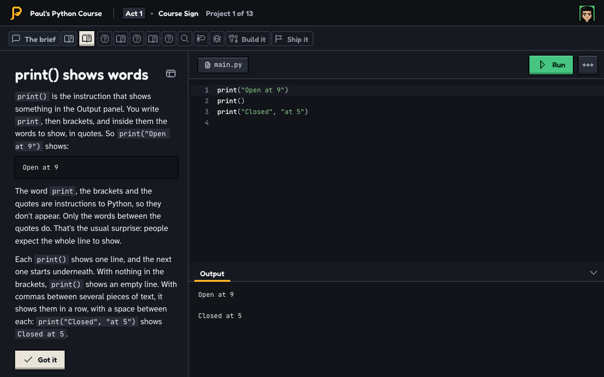

<h1 align="center">Paul Nercessian</h1>

  <b>I build machine learning systems end to end, and I teach Python to beginners.</b> 
  IB Diploma student in Dubai &nbsp;·&nbsp; applying to AI and computer science degrees for autumn 2027

  
  
  

<table align="center">
  <tr>
    <td align="center" width="20%"><h2>1,000+</h2>users on Paul's Python Course</td>
    <td align="center" width="20%"><h2>116</h2>course projects, from <code>print</code> to a tiny GPT</td>
    <td align="center" width="20%"><h2>1,484</h2>exam questions in Screening Prep, checked by 876 tests</td>
    <td align="center" width="20%"><h2>0.89</h2>ROC AUC for DriftSync's Transformer (synthetic data)</td>
    <td align="center" width="20%"><h2>20+</h2>public projects across ML, simulation, games and tools</td>
  </tr>
</table>

  <a href="#flagship-pauls-python-course">Flagship</a> &nbsp;·&nbsp;
  <a href="#machine-learning">Machine learning</a> &nbsp;·&nbsp;
  <a href="#simulation-and-learning-tools">Simulation and learning tools</a> &nbsp;·&nbsp;
  <a href="#games-and-apps">Games and apps</a> &nbsp;·&nbsp;
  <a href="#skills">Skills</a>

---

### About

I started out making games in C# and Unity, and I still work the same way now that my focus is machine learning: build the whole system end to end, ship it, then test it hard and write down what did not work. I care most about whether a result is real, so my projects come with held-out evaluation, seeded experiments and automated tests.

**Interests:** world models · sequence models · reinforcement learning · computer vision · NLP

**Now:** training LUCID on my own Unity games, and growing Paul's Python Course.

**School:** Dubai International Academy Al Barsha, IB Diploma (HL Design Technology, Business, Mathematics AI)

---

## Flagship: Paul's Python Course

**[paulspythoncourse.com](https://paulspythoncourse.com/)** started as the website for the Python class I teach and has grown to **more than 1,000 users**.

- **116 projects across nine floors of a clocktower**, from a first `print` to a neural network from scratch, a tiny GPT and reinforcement learning
- **Python runs in the browser** through Pyodide, so learners need nothing installed
- **A class register** shows me each student's progress, and I still teach the live class every week
- Built and maintained by me: front end, accounts, database and lesson content

`TypeScript` `Next.js` `Pyodide` `Supabase`

**[Open the site](https://paulspythoncourse.com/)**

---

## Machine learning

<table>
  <tr>
    <td width="50%" valign="top">
      
        
      <b><a href="https://github.com/Bouwles/lucid">LUCID</a></b> &nbsp;neural game engine
       
      A diffusion world model watches recorded play, then generates the game one frame at a time from your key presses, with no game engine, physics code or level data in the loop. EDM preconditioning and context-noise augmentation fight drift, and an evaluation suite measures image quality, long-run stability and whether the dream obeys the controls.
        
      <b>Status:</b> pipeline built and tested end to end on a synthetic test game; training on my own Unity games is next.
        
      <code>Python</code> <code>PyTorch</code> <code>Unity</code> <code>FastAPI</code>
    </td>
    <td width="50%" valign="top">
      
        
      <b><a href="https://github.com/Bouwles/DriftSync">DriftSync</a></b> &nbsp;error prediction from behaviour
       
      Predicts whether a user will make an error in the next 5 trials from their last 20. LSTM and Transformer models, MC-dropout uncertainty and live inference in a desktop app. The Transformer reaches 0.89 ROC AUC on synthetic data; testing on real people is the next step.
        
      <code>Python</code> <code>PyTorch</code> <code>Pygame</code>
        
      <a href="https://github.com/Bouwles/DriftSync">Source</a> &nbsp;·&nbsp; <a href="https://github.com/Bouwles/DriftSync/releases">Windows download</a>
    </td>
  </tr>
</table>

| Project | What it does | Stack |
| :-- | :-- | :-- |
| [**RL Chess and Snake Lab**](https://github.com/Bouwles/rl-chess-snake-lab) | DQN agent for a custom Snake environment and a self-play chess experiment, with replay memory, checkpointing, seeded configs and tests. | `Python` `PyTorch` `Gymnasium` |
| [**ASL Interpreter**](https://github.com/Bouwles/ASL-Interpreter) · [demo](https://bouwles.github.io/ASL-Interpreter/) | Turns webcam hand landmarks into English sentences in the browser, with a vote-based stability filter and a tested sentence engine. | `JavaScript` `MediaPipe` |
| [**Arabic Sentiment Analyzer**](https://github.com/Bouwles/arabic-sentiment-analyzer) | Arabic NLP pipeline with text preprocessing, a pretrained Transformer model wrapper, CLI, batch mode and a Streamlit demo. | `Python` `Transformers` `Streamlit` |

---

## Simulation and learning tools

| Project | What it does | Stack |
| :-- | :-- | :-- |
| [**Screening Prep**](https://github.com/Bouwles/mbzuai-screening-prep) · [open](https://bouwles.github.io/mbzuai-screening-prep/) | Unofficial revision site for the MBZUAI BSc in AI screening exam: 65 lessons, 1,484 questions, 177 question generators, timed mocks and spaced repetition. 876 tests check every question and 2,000 variants of each generator. | `TypeScript` `React` `Vite` |
| [**Four-Way Traffic Simulation**](https://github.com/Bouwles/Four-Way-Stochastic-Traffic-Simulation) · [demo](https://bouwles.github.io/Four-Way-Stochastic-Traffic-Simulation/) | Seeded stochastic simulation comparing equal-time and adaptive signal control over 250 paired trials with confidence intervals. Built for my IB Mathematics internal assessment. | `JavaScript` |
| [**Magnus Effect Simulation**](https://github.com/Bouwles/Physics-Magnus-Effect-Simulation) · [demo](https://bouwles.github.io/Physics-Magnus-Effect-Simulation/) | Interactive 3D simulation of spin, drag and Magnus force, with force arrows, trajectory trails and live telemetry. | `JavaScript` `Three.js` |
| [**Calculus Practice**](https://github.com/Bouwles/calculus-practice) · [open](https://bouwles.github.io/calculus-practice/) | Randomly generated derivative and integral questions, each with the rule behind its answer. One HTML file that works offline. | `JavaScript` `KaTeX` |

---

## Games and apps

**[SCRATCH](https://github.com/Bouwles/SCRATCH)** is a billiards roguelite with its own physics. Every table, texture, song and sound effect is generated in code, so the repo contains no image, audio or model files. **[Play in the browser](https://bouwles.github.io/SCRATCH/)**

<b>More games (6)</b>

 

| Project | What it is | Stack |
| :-- | :-- | :-- |
| [**Hand Cannon**](https://github.com/Bouwles/3D-Finger-Tracking-Shooter-Game) · [play](https://bouwles.github.io/3D-Finger-Tracking-Shooter-Game/) | Browser shooter you aim with your index finger and fire with your thumb, using webcam hand tracking. | `JavaScript` `MediaPipe` |
| [**RAJIS**](https://github.com/Bouwles/RAJIS) · [play](https://bouwles.github.io/RAJIS/) | First-person 3D missile defence game with wave survival and online 1v1. | `JavaScript` `Three.js` |
| [**Shatterdome Earth**](https://github.com/Bouwles/Pacific-Rim-Shatterdome-Earth) · [play](https://bouwles.github.io/Pacific-Rim-Shatterdome-Earth/) | Open-world fan game with a headless scenario runner that tests for determinism. | `TypeScript` `Babylon.js` |
| [**Mach 20**](https://github.com/Bouwles/assassination-classroom-last-bell) · [play](https://bouwles.github.io/assassination-classroom-last-bell/) | Fan game about tracking the real target through afterimages. | `JavaScript` `Vite` |
| [**Breaktime**](https://github.com/Bouwles/breaktime) | Fast top-down action roguelite for five-minute breaks. | `JavaScript` |
| [**Horse Tinder**](https://github.com/Bouwles/horse-tinder) · [play](https://bouwles.github.io/horse-tinder/) | A joke made with a friend: 45 horses to swipe on, and they text back. | `JavaScript` |

<b>Developer tools and apps (6)</b>

 

| Project | What it does | Stack |
| :-- | :-- | :-- |
| [**Assumption Archaeologist**](https://github.com/Bouwles/assumption-archaeologist) | Claude Code plugin that records the unwritten assumptions in a codebase and tracks whether they still hold. | `Claude Code` |
| [**Comment Rot Detector**](https://github.com/Bouwles/comment-rot-detector) | Claude Code plugin that flags comments which stop matching the code after an edit. | `Claude Code` |
| [**KenKen for Paul**](https://github.com/Bouwles/kenken-for-paul) · [play](https://bouwles.github.io/kenken-for-paul/) | Puzzle generator with a solver that guarantees exactly one solution, as a website and a native Mac app. | `JavaScript` `Swift` |
| [**Silo**](https://github.com/Bouwles/Silo) | macOS focus timer, task list and study analytics. | `SwiftUI` `SwiftData` |
| [**PromptForge**](https://github.com/Bouwles/PromptForge) | Local prompt writer for coding agents. | `Ollama` |
| [**PR Tracker**](https://github.com/Bouwles/nercessians-pr-tracker) | Desktop app for gym personal records and progress charts. | `Electron` `React` |

---

## Skills

**Languages** &nbsp;

**ML and data** &nbsp;

**Web and apps** &nbsp;

**Engineering** &nbsp;

---

  Get in touch: <a href="mailto:nercessianpaul@gmail.com">nercessianpaul@gmail.com</a>

